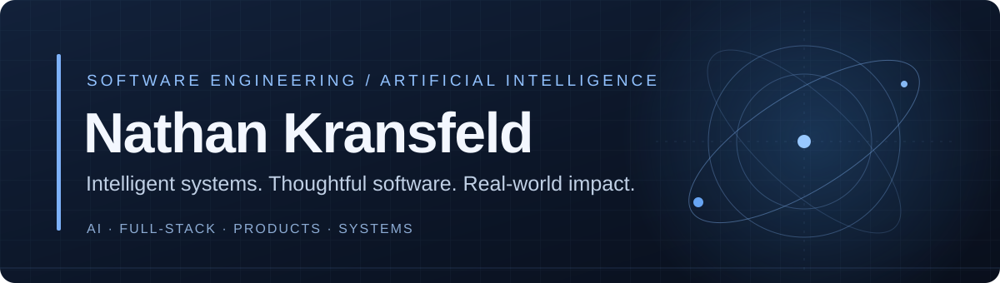

### Software Developer · AI & Full-Stack Engineering

*Building intelligent applications, thoughtful digital experiences, and practical systems that solve real problems.*

---

## About me

I'm **Nathan Kransfeld**, a software developer and University of Georgia computer science graduate (B.S., May 2026; **3.79 GPA**). I build across **AI/ML, backend systems, full-stack applications, and interactive software**.

My background combines engineering with hands-on operations leadership. I currently serve as an **Operations Manager at AMS Pools**, and I'm pursuing an **online MBA in Data Analytics at Louisiana Tech University**. Previously, I worked as a **Data Analytics Intern at Avvale**, prototyping retrieval-augmented generation (RAG) workflows in Databricks. That experience is shared at a high level; employer-owned code and data remain private.

I also run **[Kransfeld Studios](https://kransfeldstudios.com)**, where I create custom websites and digital experiences.

## Selected work

<table>
<tr>
<td width="50%" valign="top">

### 🚀 [SpaceCourier](https://github.com/DarthPlagueis123/SpaceCourier)

**Reinforcement learning meets arcade gameplay**

A playable Python game with a PyTorch **Double DQN** agent, deterministic evaluation, training visualizations and automated tests.

**8.37×** the random policy's mean score in the project's recorded 100-episode evaluation.

[Explore the project →](https://github.com/DarthPlagueis123/SpaceCourier)

</td>
<td width="50%" valign="top">

### 🌐 [Kransfeld Studios](https://kransfeldstudios.com)

**Independent web design and development**

Custom websites, responsive experiences and interactive design concepts built with attention to motion, usability and performance.

The business's production source code is **private**.

[View the portfolio →](https://kransfeldstudios.com)

</td>
</tr>
<tr>
<td width="50%" valign="top">

### 🎮 Emberfall

**Independent game development**

A dark-fantasy pixel-art action platformer built with Godot, featuring character abilities, enemy AI, boss encounters and cross-platform input support.

Commercial game code and assets remain **private**. A public showcase is planned.

</td>
<td width="50%" valign="top">

### 🧠 Applied AI & Data Systems

**Document intelligence and practical automation**

Experience prototyping document retrieval and RAG-powered business workflows using Databricks and AI development tools during my Avvale internship.

Employer source code, documents and internal details are **not published**.

</td>
</tr>
</table>

## Tech I work with

| Area | Technologies |
|:--|:--|
| **Languages** | Java, Python, C/C++, JavaScript, SQL |
| **Web & APIs** | React, Node.js, Express, Spring Boot, HTML, CSS, REST APIs |
| **Data & storage** | PostgreSQL, MySQL, SQLite, Firebase, Supabase |
| **AI & development** | PyTorch, Databricks, Git, GitHub, Docker, Maven, Gradle, Linux |

## Experience & education

- **Operations Manager — AMS Pools:** Led operations across multiple aquatic facilities, including staffing, training, and facility readiness. Previously managed 100+ lifeguards across 18 pools as an Area Manager.
- **Data Analytics Intern — Avvale (Sep 2025 – May 2026):** Built and refined Databricks/RAG prototypes for document retrieval and invoice-related workflows.
- **B.S. Computer Science — University of Georgia (May 2026):** GPA 3.79.
- **MBA, Data Analytics — Louisiana Tech University:** In progress, online.
- **UGA CodeHub Spring 2026 Project Track winner:** Co-developed a React/Spring Boot health dashboard.

## What I'm focusing on

- Improving reproducibility and evaluation for **SpaceCourier's reinforcement learning agents**.
- Building reliable **AI-enabled business applications**.
- Developing independent products and digital experiences through **Kransfeld Studios**.

---

**Interested in working together?** Let's connect.

[Website](https://kransfeldstudios.com) · [LinkedIn](https://www.linkedin.com/in/nathan-kransfeld-435843288/) · [Email](mailto:nate_kransfeld@outlook.com)

Built with intention. Always improving.

